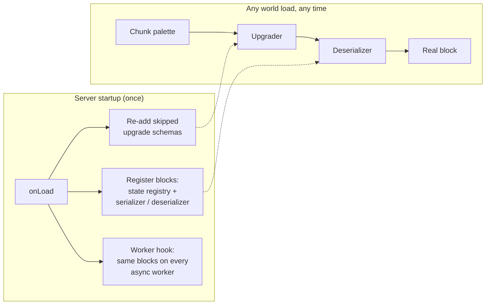

<div align="center">

# 🧱 BlockLoader

**Loads the blocks PocketMine-MP can't read, and repairs chests that won't open and chunks that won't load, so your maps just work: no `update!` blocks, no wall of chunk errors.**


[The problem](#-the-problem) ·
[What it fixes](#-what-it-fixes) ·
[Chests that won't open](#-chests-that-wont-open) ·
[Chunks that won't load](#-chunks-that-wont-load) ·
[How it works](#%EF%B8%8F-how-it-works) ·
[Install](#-install) ·
[Configuration](#%EF%B8%8F-configuration) ·
[Performance](#-performance) ·
[Limitations](#-limitations)

</div>

---

## 🧩 The problem

Load a map built in vanilla Bedrock (or converted with a world tool) and the console fills with this,
**every time the map is loaded**. On a minigame server that means every match, since the waiting map is copied
for each game:

```
[World Provider: waiting_6a4237cbe979d] [Loading chunk x=0 z=0 v41] [Subchunk y=5 v8] Errors decoding blocks:
 - Unknown block ID "minecraft:moss_block" (palette offsets: 9)

[World Provider: tntrun_waitinglobby] [Loading chunk x=0 z=0 v41] [Subchunk y=6 v9] Errors decoding blocks:
 - Deserialize error: Property "minecraft:corner" is missing, NBT: TAG_Compound={
  "name" => TAG_String="minecraft:smooth_quartz_stairs"
  "version" => TAG_Int=18179072
  ...
```

Players then see those blocks as `update!` blocks. Two separate causes are behind it:

| Error | Cause |
| --- | --- |
| `Unknown block ID "minecraft:…"` | The block exists in vanilla, but PocketMine doesn't implement it |
| `Property "minecraft:corner" is missing` (stairs)<br>`Property "minecraft:connection_east" is missing` (fences) | Mojang stopped raising the block-state version after **1.21.60.33**, so every newer upgrade schema carries that old number. A map saved with a higher number (1.21.100 in the example) is treated as *already upgraded*, so those upgrades are skipped. |

## ✅ What it fixes

**New blocks.** The client already knows these. Once the server can read and write them, players see the real
block with its rotation and state:

| Block | Saved states kept |
| --- | --- |
| `moss_block`, `moss_carpet`, `conduit` | — |
| `kelp` | `kelp_age` |
| `seagrass` | `sea_grass_type` |
| `piston`, `sticky_piston` | `facing_direction` |
| `piston_arm_collision`, `sticky_piston_arm_collision` | `facing_direction` |
| `dropper`, `dispenser` | `facing_direction`, `triggered_bit` |
| `composter` | `composter_fill_level` |
| `frog_spawn` | — |

**Skipped upgrades.** These are re-applied to blocks of every version:

- Stairs get `minecraft:corner`
- Fences get `minecraft:connection_*`
- `minecraft:chain` becomes `minecraft:iron_chain`
- …plus anything else in those schemas

The upgrades are read from the server's own schema files, so when a newer server build ships more of them, they
are picked up automatically.

**Anything else.** `aliases` loads any other unknown ID as a block of your choice.

## 🧰 Chests that won't open

Some maps have chests that do nothing when clicked, and the only fix used to be breaking and placing them again.
The cause is a chest **block** saved without its **block entity** (the part that holds the inventory). WorldEdit
pastes and world converters often do this. Vanilla quietly recreates it; PocketMine doesn't, and logs nothing.

It's common. In a scan of 59 SkyWars and Survival Games maps, **208 of 3,370 chests** had no block entity.
SW-Cliffs alone had 18 of 45.

When a player clicks such a block, BlockLoader writes it again in place, which is exactly what breaking and
placing does. The block entity comes back before the click is handled, so **the chest opens on that same click**.

- Works for every block that needs a block entity: chests, trapped chests, barrels, furnaces, hoppers…
- The other half of a double chest is repaired too, and the halves are paired like vanilla placement
  (54-slot inventory).
- Runs at `LOWEST` priority, so minigame loot plugins already see the repaired chest.
- In an edit world, the repair is saved with the map, so clicking each chest once fixes the map for good.
- Nothing runs on chunk load. A block that already has its block entity is left alone.

## 🗺️ Chunks that won't load

Some world tools save a chunk's biomes as "same as the sub-chunk below" for **every** sub-chunk, including the
first one, which has nothing below it. PocketMine rejects the whole chunk, and its terrain never loads:

```
[World: Arcade-Lobby] Failed to load chunk x=-4 z=2: Serialized biome palette 0 has no previous palette to copy from
```

In the Arcade lobby map, that was **226 of 306 chunks**.

BlockLoader puts in a LevelDB provider that loads chunks exactly as before. Only when a chunk fails with
**that exact error**, the first marker is replaced with a single plains biome (the rest still copy it), the
repaired data is saved into that chunk, and the chunk is loaded again.

- Healthy chunks: no change, no extra work.
- Broken chunks: repaired once; from the next load on they are ordinary chunks.

## ⚙️ How it works



- Everything is registered in `onLoad`, before any world loads. Worlds that don't exist yet are covered too,
  such as minigame maps copied and loaded mid-game, because chunk decoding uses the same global tables.
- **Nothing listens to chunk loads.** No events, no chunk scanning, no tasks.
- Block type IDs are picked on the main thread and handed to every async worker, so lighting and generation
  there see identical state IDs.
- Upgrade schemas are only re-added when running them twice changes nothing: renamed IDs, added and removed
  properties. Schemas with value remaps are left alone.

Written against the [kostamax PocketMine-MP-NG](https://github.com/kostamax27/PocketMine-MP-NG) fork
(multi-protocol) and tested on it. Recent upstream PocketMine-MP 5 builds share the block-state APIs it uses,
but haven't been tested.

## 📦 Install

1. Drop the plugin into `plugins/`.
2. Restart. You'll see something like:
   ```
   [BlockLoader] Re-applying 3 block upgrade schema(s) for maps saved with a newer block version
   [BlockLoader] Loaded 13 block(s): minecraft:moss_block, minecraft:moss_carpet, ...
   ```
3. Load your map. The errors are gone.

> Must be installed on the server that **loads the map**, e.g. every minigame backend.

## 🛠️ Configuration

`plugins/BlockLoader/config.yml`

| Key | Default | Meaning |
| --- | --- | --- |
| `tile-fix` | `true` | Repair chests (and other containers) missing their block entity when they're clicked |
| `upgrade-fix` | `true` | Re-apply the upgrade schemas the server skips (stairs `corner`, fences `connection_*`, …) |
| `biome-fix` | `true` | Repair and load chunks that fail with `Serialized biome palette 0 has no previous palette to copy from` |
| `disabled-blocks` | `[]` | Blocks to leave to PocketMine. Every block BlockLoader adds is on unless listed here, including ones added in future versions |
| `aliases` | `{}` | Load other unknown IDs as an existing block **without states** |

```yaml
aliases:
  minecraft:some_new_block: minecraft:stone
```

An aliased block is saved as its target if a chunk containing it changes.

## ⚡ Performance

Measured on PHP 8.4 (pmmp build), decoding one palette entry (what the server does for each distinct block in a
16×16×16 sub-chunk):

| | Without BlockLoader | With BlockLoader |
| --- | --- | --- |
| `moss_block` | 2.35 µs **+ an ERROR log line per sub-chunk**, shown as `update!` | 2.40 µs, real block |
| Any block (re-added upgrades) | 2.98 µs | 4.24 µs |

The extra **~1.3 µs per palette entry** comes to well under 1 ms for a full chunk, and is only paid while a chunk
loads. In exchange, the formatting, console output and log writes for thousands of error lines go away. One log
from a real minigame server had **25,000+**.

## 🧪 Verified

Each case uses the exact NBT from a real server log, decoded by the fork's own upgrader and deserializer:

| Case | Before | After |
| --- | --- | --- |
| `moss_block`, `moss_carpet`, `conduit` | ❌ Unknown block ID | ✅ saved back unchanged |
| `kelp` (age 7), `seagrass` (double_top) | ❌ Unknown block ID | ✅ states kept |
| `sticky_piston`, `piston_arm_collision`, `dropper` | ❌ Unknown block ID | ✅ facing + triggered kept |
| `smooth_quartz_stairs`, `mossy_stone_brick_stairs` @ 1.21.100 | ❌ `minecraft:corner` missing | ✅ `corner=none` added |
| `dark_oak_fence` @ 1.21.100 | ❌ `minecraft:connection_east` missing | ✅ connections added |
| `chain` @ 1.21.100 | ❌ Unknown block ID | ✅ renamed to `iron_chain` |
| Already-correct 1.26 stairs | ✅ | ✅ unchanged |
| Client network ID, all 32 protocols the fork accepts (589 → 2193) | — | ✅ real block, never `update!` |
| State IDs main thread vs async worker | — | ✅ identical |
| SW-Cliffs: 18 chests without block entity, on a real NG server | ❌ won't open | ✅ block entity on first click (0.46 ms for all 18), still there after save + reload |
| Double chest with both block entities missing | ❌ won't open | ✅ both repaired and paired, 54 slots |
| Real Arcade lobby map: 226 chunks with broken biomes | ❌ 226 CRITICAL, 80 of 306 chunks load | ✅ 0 errors, 306 of 306 load, repair saved (second start: nothing to repair) |
| `composter` (fill level 3), `frog_spawn` | ❌ Unknown block ID | ✅ states kept, real block on every protocol |
| Upgrading with a 1.0 / 1.1 `config.yml` | — | ✅ new blocks load too |

## 📝 Limitations

- The new blocks are **decorative**. Pistons don't push, droppers have no inventory, kelp doesn't grow, and the
  conduit gives no effect. They look, rotate and break like vanilla, which is what a map needs.
- Fixed blocks are written back in the current format only if the server re-saves the chunk. The plugin never
  rewrites map files on its own.
- `aliases` only accepts targets without states (`minecraft:stone`, not `minecraft:oak_stairs`).
- Install BlockLoader **before** a map is loaded for the first time. Without it, PocketMine replaces unknown
  blocks with `update!`, and if that chunk gets saved, the original block is gone from the map file.
- Repaired biomes are plains. The broken data held no biome at all, so there was nothing to restore.
